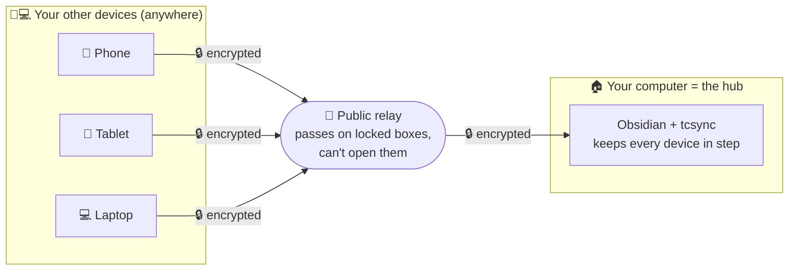
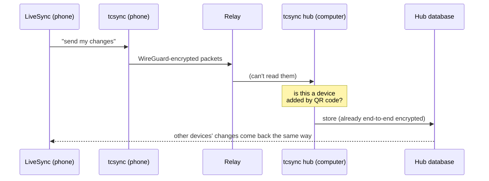

# tcsync

### Sync your Obsidian notes between your devices — through your own computer. No account, no cloud, no server to run.

tcsync turns **Obsidian on your computer into a private sync hub**. Your phone, tablet and other computers sync with it from anywhere — home Wi-Fi, mobile data, a café — through an encrypted tunnel. Your notes are never stored on anyone else's machine.

Setting it up is **one switch on your computer and one QR code per phone**. You never type a password, copy a key or open a terminal.



**In one sentence:** your devices send their changes, locked with your own key, through a public relay to Obsidian on your computer, which passes them on to your other devices.

---

## ✅ Before you start

You need:

- **One computer** (Mac, Windows or Linux) with [Obsidian](https://obsidian.md) installed. This is **the hub**. It holds your notes and must be **switched on, with Obsidian open**, for your devices to sync. Pick the computer that is on most often.
- **Your phone, tablet or other computers**, each with Obsidian installed (Android and desktop are tested; iPhone/iPad is untested).
- **About 10 minutes.**

> 💾 **Make a copy of your vault folder first.** tcsync never deletes notes, but a backup costs nothing and protects you from anything going wrong.

---

## 🖥️ Part 1 — on your computer (do this once)

1. **Open Obsidian** and open the vault (notes folder) you want to sync.
2. **Turn on community plugins:** ⚙️ **Settings** → **Community plugins** → **Turn on community plugins**.
3. **Install BRAT** (it installs plugins that aren't in the store yet): **Community plugins** → **Browse** → search **BRAT** → **Install** → **Enable**.
4. **Install tcsync with BRAT:** ⚙️ **Settings** → **BRAT** → **Add beta plugin** → paste `englishcompiler/tcsync` → **Add plugin**. Then **Community plugins** → make sure **tcsync** is switched **on**.
5. **Install Self-hosted LiveSync:** ⚙️ **Settings** → **tcsync** → press **Install Self-hosted LiveSync** → **Install** → **Enable**. (tcsync uses it to do the actual syncing.)
6. **Make this computer the hub:** ⚙️ **Settings** → **tcsync** → **This device is…** → choose **The hub (this computer)** → press **Make this computer the hub**.
7. **Wait.** Obsidian restarts by itself, then shows *"tcsync: setting up the hub…"*. After about a minute you'll see ***"the hub is ready"***. Don't click anything in between — tcsync answers Self-hosted LiveSync's questions for you.

**Check:** the bottom-right of the window says **`tcsync: hub on · 0`**. ✅

---

## 📱 Part 2 — on each phone, tablet or other computer

Do this once per device.

1. **Install Obsidian** and **create a new, empty vault** (any name is fine — e.g. *My notes*). Obsidian needs a vault before it can install plugins.
2. **Turn on community plugins, install BRAT, then tcsync, then Self-hosted LiveSync** — exactly like steps 2–5 of Part 1, on this device.
3. **On your computer:** ⚙️ **Settings** → **tcsync** → **Add a device** → type a name (e.g. *My phone*) → **Show code**. A QR code appears. Leave it open.
4. **On the phone:** open the **camera app**, point it at the QR code and **tap the link** that pops up. Obsidian opens and asks *"Pair this vault with …?"* → tap **Pair**.
   - *On a computer (no camera):* on the hub press **Copy link**, send it to yourself, then on the new computer go to ⚙️ **Settings** → **tcsync** → **Paste pairing link**.
5. **Wait.** Obsidian restarts by itself, then shows *"downloading your notes from the hub…"*, then ***"paired. Your notes now sync with your hub."*** The QR window on your computer changes to **✅ Paired**.

**Check:** write a note on the phone — it appears on your computer within a few seconds, and the other way round. ✅

> 💡 The QR code works for **10 minutes** and for **one device**. For the next device, press **Add a device** again.

---

## 👀 What to expect

- **Sync is live.** Changes usually arrive on your other devices in **5–10 seconds**.
- **Your computer is the meeting point.** When it's off, asleep, or Obsidian is closed there, your devices show *"Hub is offline. Changes are saved and will sync when your computer is back."* Keep writing — everything catches up automatically later.
- **tcsync keeps the hub awake** while Obsidian is open (you can turn this off in ⚙️ **Settings** → **tcsync**). It does **not** keep the computer on when you close the lid or shut it down.
- **First sync of a big vault** (lots of images or PDFs) can take a while. Do it on Wi-Fi.
- **Notes already on a device are never thrown away.** When a device pairs, its existing notes are merged with the hub's, and a backup zip (`tcsync-backup-….zip`) is saved in that vault first. If the same note was changed in two places, both versions are kept.

## 🧭 Where to see what's going on

- **Computer:** bottom-right status bar — `tcsync: hub on · 2` (two paired devices), `tcsync: synced`, `tcsync: hub offline`.
- **Phone:** ⚙️ **Settings** → **tcsync** shows the same status in plain words (phones don't have a status bar).

## 🛠️ If something isn't working

| You see | What it means | What to do |
|---|---|---|
| *Hub is offline…* | Your computer is off/asleep, or Obsidian isn't open on it. | Turn the computer on and open Obsidian. Sync resumes by itself. |
| *…this device isn't paired any more* | The device was removed on the hub, or the hub was reset. | On the computer: **Add a device**, then scan the new code. |
| *This code has expired* | The QR code is older than 10 minutes or was already used. | On the computer: **Add a device** again. |
| *Install Self-hosted LiveSync* | The helper plugin is missing on this device. | Press the button, **Install**, **Enable**. Pairing continues by itself. |
| Nothing happens when you scan | The camera didn't hand the link to Obsidian. | On the hub press **Copy link**, send it to the phone, tap it there (or paste it in tcsync's settings). |
| *Hub problem: …* | The hub couldn't start (e.g. no internet). | Check the computer's internet connection, then restart Obsidian. |

**Please don't** change Self-hosted LiveSync's own settings or run its setup wizard — tcsync configures it for you, and changing it can stop syncing. Leave LiveSync's *Hidden file sync* and *Customisation sync* off unless you know you need them.

## 📋 Everyday tasks

- **Add another device:** ⚙️ **Settings** → **tcsync** → **Add a device** (on the computer).
- **Remove a lost or old device:** ⚙️ **Settings** → **tcsync** → next to the device → **Remove**. It stops syncing immediately.
- **Stop using a computer as the hub:** ⚙️ **Settings** → **tcsync** → **This device is…** → **Syncing with a hub**. Nothing is deleted; your devices pause until a hub is back.

---

## 🔐 Why it's private

- **Locked before it leaves.** Every note and file name is encrypted on your device with a key that only your devices have. tcsync creates that key for you and passes it to each device inside the QR code.
- **A sealed tunnel.** Devices talk to your computer through a WireGuard® tunnel. Only devices you added with a QR code get in — everyone else is ignored, even if they knew your hub's address.
- **No open doors.** Nothing is exposed on your computer or router; no port forwarding.
- **The relay can't read anything.** Phones can't connect directly to your computer, so the encrypted traffic passes through a public relay run by the tailcat project. It only ever sees locked boxes.
- **No account, no subscription, no third party holding your notes.**

## 🤓 How it works (for the curious)

tcsync combines two open-source projects:

- **[Self-hosted LiveSync](https://github.com/vrtmrz/obsidian-livesync)** does the actual syncing, with end-to-end encryption. It normally needs a CouchDB server; **tcsync's hub replaces that server** with a small CouchDB-compatible database (PouchDB) running inside Obsidian on your computer.
- **[tailcat](https://github.com/tailscale/tailcat)** — Tailscale's encrypted tunnel without accounts — compiled to WebAssembly so it runs **inside the plugin**, on desktop and on Android, with no VPN app.



The full technical picture — request flow, security model, where everything is stored — is in **[docs/architecture.md](docs/architecture.md)**.

## 🧰 Advanced: your own always-on server

If you'd rather run a separate, always-on CouchDB server (a Raspberry Pi, NAS or VM) so devices can sync even when your computer is off, tcsync supports that too: choose **Advanced: my own server** and follow **[docs/setup.md](docs/setup.md)**. Most people don't need this.

## Building from source

Requires Go 1.27.4+ (fetched automatically through `GOTOOLCHAIN`) and Node 20+.

```sh
npm ci
npm test                 # unit tests
npm run build            # builds bridge/dist/tcsync.wasm, then main.js
TAILCAT_BIN=/path/to/tailcat bridge/test/run.sh                         # tunnel integration tests (needs network)
LIVESYNC_DIR=/path/to/obsidian-livesync node test/e2e/hub-e2e.mjs /tmp/e2e   # end-to-end in real Obsidian (macOS)
```

Releases are built by GitHub Actions when a version tag (`x.y.z`) is pushed.

## License

MIT. `main.js` embeds tailcat and Tailscale code (BSD-3-Clause), PouchDB (Apache-2.0) and fflate/qrcode-generator (MIT); `server/setup-uri.mjs` is adapted from Self-hosted LiveSync (MIT). See [LICENSE](LICENSE). WireGuard is a registered trademark of Jason A. Donenfeld.
