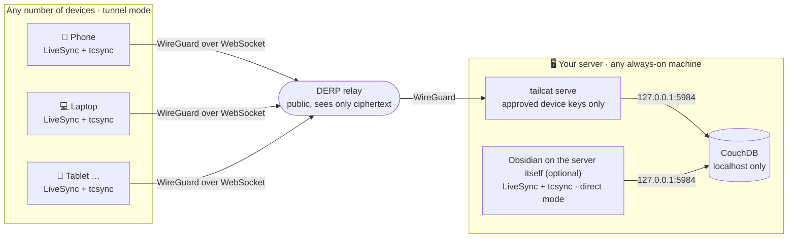

# tcsync

### Your notes. Your server. Every device. No open ports.

**tcsync turns any machine you own into a private, end-to-end-encrypted sync hub for Obsidian.** That machine can be a home computer, a Raspberry Pi, a NAS or a cheap VM. Phones, tablets and laptops anywhere in the world can reach it with no port forwarding, no VPN app, no Termux and no subscription.

It pairs the battle-tested [Self-hosted LiveSync](https://github.com/vrtmrz/obsidian-livesync) with a [tailcat](https://github.com/tailscale/tailcat) WireGuard tunnel that runs **inside Obsidian itself**, compiled to WebAssembly. Install one plugin, approve the device, and it syncs.



## Why tcsync

- **🔒 Nothing exposed to the internet.** CouchDB listens on `127.0.0.1` only. There's no port to forward, no firewall rule, and no public endpoint to scan or attack.
- **🛡️ Three independent locks.**
  - The tunnel admits only device keys you approved.
  - CouchDB requires a password.
  - LiveSync encrypts every note and file name on the device before it leaves.

  The relay in the middle sees only ciphertext.
- **📱 Works in the stock Obsidian app.** The WireGuard tunnel runs inside the plugin, so Android needs no extra app, root, Termux or VPN slot. It works on desktop too.
- **♾️ One server, unlimited devices.** Every device gets its own key. Add a new phone in one command, and revoke a lost one in another, without touching the rest.
- **⚡ Real-time sync.** It runs LiveSync's live mode through the tunnel. In testing, an edit on one device appeared on another about 2 seconds later.
- **🧰 Your hardware, your data.** It runs on a Mac you already have, a Raspberry Pi in a drawer, a NAS, or a $4 VM. There's no subscription and no third party holding your notes.
- **🔁 Set it and forget it.** On macOS, one script installs CouchDB in Docker and a tunnel service that survives reboots. One setup link configures LiveSync on every device, with encryption on.
- **📦 Zero runtime downloads.** The whole tunnel ships inside the plugin (about 8 MB), so nothing is fetched or executed later.

## How it works, in plain words

1. **LiveSync does the syncing.** It keeps your vault in a CouchDB database and pushes and pulls changes.
2. **CouchDB lives on your server and only listens to that machine.** The internet can't reach it.
3. **tcsync gives LiveSync a private address, `couch.tailcat`.** When LiveSync talks to it, tcsync catches the request and sends it through an encrypted **WireGuard** tunnel to your server.
4. **Phone apps can't open raw network connections**, so the encrypted packets ride a normal WebSocket through a public **relay** (Tailscale's DERP). The relay forwards bytes it can't read.
5. **On your server, `tailcat serve` receives the tunnel.** It checks that the device key is on your allowlist, then hands the request to CouchDB.
6. **If you also use Obsidian on the server itself**, tcsync there runs in *direct mode* and points `couch.tailcat` at `127.0.0.1`. Every device, server included, shares the same LiveSync settings.

Want the packet-level view? See the step-by-step sequence diagram and threat model in **[docs/architecture.md](docs/architecture.md)**.

## Quick start

1. **Server:** on macOS, clone this repo and run `server/setup.sh`. It prints your server address. For Linux, a Raspberry Pi, a NAS or a VM, follow the [manual steps](docs/setup.md#2-server-manual-linux-or-any-docker-host).
2. **Every device:** install **Self-hosted LiveSync** from Community plugins, and **tcsync** with [BRAT](https://github.com/TfTHacker/obsidian42-brat) (`englishcompiler/tcsync`).
3. **Approve it:** paste the server address into tcsync's settings and copy the device key. On the server, run `server/allow.sh add <device key> "device name"`.
4. **Obsidian on the server itself (if any):** set tcsync to **Direct** mode.
5. **Connect:** run `server/setup-uri.sh` and open the printed link on each device. LiveSync configures itself, with encryption on.

That's it. The full from-scratch guide, including configuring LiveSync by hand, troubleshooting, backup and uninstall, is in **[docs/setup.md](docs/setup.md)**.

## Good to know

- **The server must be awake for devices to sync.** Edits made meanwhile wait safely on each device and sync later. An always-on box (Raspberry Pi, NAS, VM) makes this a non-issue.
- **Traffic from inside the app is always relayed**, because apps can't send raw UDP. Expect about 300 ms per request and roughly 0.5 MB/s: day-to-day note syncing feels instant, but do the *first* sync of a large vault on Wi-Fi.
- tcsync uses tailcat's free public DERP relays, which are rate-limited. You can [run your own relay](https://github.com/tailscale/tailscale/tree/main/cmd/derper#derp).
- Tested with Self-hosted LiveSync **1.0.50** and Obsidian **1.15** on macOS and Android. iOS is untested.
- tcsync must load **before** LiveSync. On first start it fixes the order itself and asks you to restart Obsidian once. It hooks LiveSync's internal HTTP functions, so a future LiveSync release could need a tcsync update.

## Building from source

Requires Go 1.27.4+ (fetched automatically through `GOTOOLCHAIN`) and Node 20+.

```sh
npm ci
npm test                 # plugin unit tests
npm run build            # builds bridge/dist/tcsync.wasm, then main.js
TAILCAT_BIN=$(command -v tailcat) bridge/test/run.sh   # bridge integration tests (needs network)
```

Releases are built by GitHub Actions when a version tag (`x.y.z`) is pushed. The release assets are `main.js`, `manifest.json` and `styles.css`.

## License

MIT. `main.js` embeds tailcat and Tailscale code (BSD-3-Clause), and `server/setup-uri.mjs` is adapted from Self-hosted LiveSync (MIT). See [LICENSE](LICENSE).
