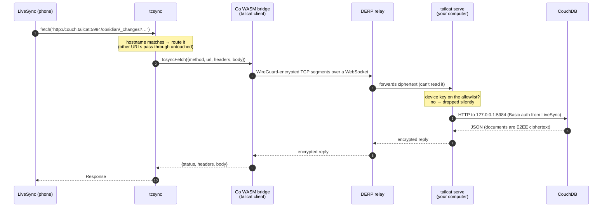

# How tcsync works

## One sync request, step by step



## Request path

```
Device (tunnel mode)
  Self-hosted LiveSync ─ fetch("http://couch.tailcat:5984/obsidian/_changes?…")
        │  tcsync replaced LiveSync's webCompatFetch/nativeFetch (and globalThis.fetch as a fallback);
        │  only URLs whose hostname is the tunnel hostname are taken, everything else passes through.
        ▼
  tcsync Connection ─ single-flight connect, backoff 1 s → 60 s, 30 s request timeout,
        │            honours AbortSignal; LiveSync's live feed (longpoll + heartbeat) is rewritten
        │            to timeout=25000 so it answers within 25 s even when nothing changed
        │            (60 s limit), keeping a dead tunnel detectable within about 30 s
        ▼
  Go WebAssembly bridge (embedded in main.js, gzip + base64, about 8 MB)
        │  net/http client whose dialer is tailcat.Client.DialTCPPort; connections are kept alive and reused
        ▼
  tailcat client: WireGuard + userspace TCP/IP (gVisor netstack), keyed by this device's node key
        │  DERP relay protocol over a WebSocket to a public tailcat DERP server
        ▼
Server
  tailcat serve --key=tcsync --allow=<approved node keys> 5984   (launchd or systemd service)
        │  forwards tunnel TCP port 5984 to localhost:5984
        ▼
  CouchDB 3.4 on 127.0.0.1:5984 (Docker), login required
```

**Direct mode** is for the computer that runs CouchDB. tcsync rewrites `http://couch.tailcat:5984/…` to the direct URL (default `http://127.0.0.1:5984/…`) and hands the request back to LiveSync's own HTTP function. The WebAssembly bridge is never loaded. Because every device uses the same LiveSync Server URI, one setup link configures all of them.

## Why the tunnel is relay-only

tailcat normally upgrades a DERP-relayed connection to a direct peer-to-peer UDP path. Code running in a WebView (Obsidian mobile) or an Electron renderer (Obsidian desktop) can't send raw UDP, so the WebAssembly build reaches DERP over WebSockets and stays on the relay. The cost is latency (about 300 ms per request) and throughput (about 0.5 MB/s on the public relays). Native tailcat on the server side is unaffected.

## Security model

| Who | Can see or do |
|---|---|
| The DERP relay operator | That two keys exchanged encrypted packets, when, and roughly how much. Not the content: traffic is WireGuard-encrypted end to end between device and server, and tailcat adds a pre-shared key. |
| Someone who learns the server address (`tc…`) | Nothing by default. The server runs with `--allow`, which admits only approved device keys, and **an empty allowlist admits no one**. |
| An approved device without the CouchDB password | It reaches CouchDB's login prompt only (`require_valid_user`). |
| Anyone with CouchDB access (including the server's own disk) | Only encrypted documents and obfuscated paths. LiveSync encrypts content and file names on each device with the end-to-end passphrase. |
| Other machines on the server's network | Nothing. CouchDB is bound to `127.0.0.1`, and no port is opened. |

## Where things live

| Item | Location |
|---|---|
| Device key (private) | tcsync's plugin data in the vault: `.obsidian/plugins/tcsync/data.json` (`privateKey`). One per vault per device. |
| Server identity | `~/Library/Application Support/tailcat/keys/tcsync.private.json` (macOS) or tailcat's config dir (Linux) |
| Allowlist | `~/.config/tcsync/allowlist` |
| Server address | `~/.config/tcsync/address`, also shown by `server/status.sh` |
| CouchDB data and config | Docker volumes `tcsync-couchdb-data`, `tcsync-couchdb-config` |
| Secrets (macOS) | Keychain, service `tcsync`: `couchdb-password`, `e2ee-passphrase`, `id-recovery-code` |
| Tunnel logs (macOS) | `~/Library/Logs/tcsync/serve.log` |

## How tcsync attaches to LiveSync

Self-hosted LiveSync sends CouchDB requests through two functions on its API service: `webCompatFetch`, the browser-style fetch, and `nativeFetch`, Obsidian's `requestUrl`. tcsync wraps both during its own `onload` (retrying every 100 ms for up to 30 s if LiveSync isn't loaded yet) and restores them when tcsync is disabled. After unload, any wrapper LiveSync still holds passes requests straight through. It also wraps `globalThis.fetch`, so routing keeps working if a future LiveSync version renames those internals. LiveSync's Fast Fetch (used during setup) calls a private copy of `fetch` that LiveSync binds when its code first loads. tcsync therefore patches `fetch` synchronously at the start of its `onload`, and keeps itself ahead of LiveSync in `community-plugins.json`. Obsidian loads plugins in that order, so the copy LiveSync binds is already tcsync's. If tcsync finds LiveSync already loaded (for example on first enable), it fixes the order, including in Obsidian's in-memory list so Obsidian's own save keeps it, and asks for one restart.

When Obsidian comes back to the foreground after more than 30 s in the background, tcsync pings the server over the existing tunnel and reconnects if the ping fails. The relay connection often dies while a phone app is frozen. These are internal LiveSync APIs. tcsync is tested against LiveSync 1.0.50.

## Building blocks

- [tailcat](https://github.com/tailscale/tailcat) v0.7.0: Tailscale's data plane without its control plane. tcsync builds it with the release build tags, which drop unused Tailscale features.
- Go 1.27.4 `js/wasm` and the Go runtime's `wasm_exec.js`.
- Self-hosted LiveSync's CouchDB provisioning rules and setup-URI format, through `@vrtmrz/livesync-commonlib`.
